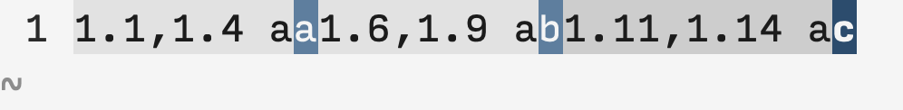

If I don't need a mouse, I don't want it. I love my keyboard, my keyboard driven editor, my keyboard shortcuts, my keyboard layout. Nothing can replace the efficency, the speed, and the sense of control. But, I will concede, there are moments when the mouse wins. Take, for example, the selection and navigation of arbitrary portions of text. You simply click wherever you want to go, or you drag your mouse and the selection follows.

The [Helix][helix] feature I missed the most when I first tried [Kakoune][kak] was `goto_word`. Just hit `gw`, and your buffer lights up with countless two-character labels. When you type a label, your cursor warps to the word underneath. It turns out, in this case, we don't need the mouse after all. 

I'm writing this to explore [Mathieu Ablasou][author]'s [Jump Mode][src], my favorite implementation of this feature for my favorite piece of software. It relies only on built-in features, and is a clever and well-made demonstration of how Kakoune can be extended.

In effect, this plugin allows you to navigate text faster than with a mouse and with nearly the same precision. I find this particularly  convenient in contexts where structural navigation is unhelpful, as with prose (more on editing prose in "[Kakoune Chronicles II](/thoughts/kakoune-chronicles-2)").

If it wasn't exciting enough, this feature, when combined with Kakoune's marks system, allows us to easily make arbitrary and disjoint selections, far beyond the capabilites of click and drag, and especially powerful in a multi-cursor, selection-centric editing model.

I will first give a short overview of using marks manually in Kakoune to motivate the necessity of improvement. I will then walk through much of Ablasou's code as an exercise (and to the best of my ability). I will end with a short example of the plugin in use. 

## Marks

Marks in Kakoune seem, at first, no more than complicated bookmarks. Indeed, `Z` saves your selections to a register and `z` restores them, even across buffers. 

Though a wonderful feature on its own, a mark in a register may be restored and combined with a selection in the buffer and a selection in the buffer may be merged into a register. The corresponding keys are `<a-Z>` and `<a-z>`, respectively. In either case, we are given the choice to append the selections with `a`, keep their union with `u`, or keep their intersection with `i`. The first choice is clear, but the union and intersection work unexpectedly. Both require an equal amount of selections in the buffer and the register, and take, by pairs, either the region enclosed by the outside points for a union or the region between the inside points for an intersection.

```cpp
// kakoune src/normal.cc

// union
sel.set(std::min(sel.min(), other.min()),
        std::max(sel.max(), other.max()));

// intersection
sel.set(std::max(sel.min(), other.min()),
        std::min(sel.max(), other.max()));
```


A common use of marks is to create multiple cursors manually across a buffer. `C` and `s` are powerful and convenient, but often restrictive. However, it is clearly too much work to repeat `<a-Z>a` every time we want to add a selection to a mark.

As another example, suppose we are renaming a complicated expression by selecting all of its occurances in a region with `s`, perhaps followed by some other commands applied to the new selections. However, we might notice that a typo in one variable caused it not to match the regex. Instead of starting over, fixing the typo and trying to remember a complicated series of keys, we save our work with `Z`, select the mistake manually, and append the mark to our selection with `<a-z>`.

## Jump Mode

It is essential to understand marks because Jump Mode works by creating a mark on a selected word. The rest of the plugin's functionality is no more than a wrapper around the restoration of that mark. Depending on which combination mode we use, including none at all, we can either jump to a word to easily navigate text without a mouse, append the new mark to avoid navigating manually and straining on `<a-Z>`, or extend to any word in the buffer just as fast as click-and-drag. 

In walking through the plugin, I will focus on the creation of the mark. I will not describe how input and faces are handled. I will be including example code from a version I have slightly modified. Please see the [original plugin][src] and [my version][src_modified] for reference. 

## Creating the Jump Mark

### Select Words in Viewport

The first step in marking a particular word is to create the candidates. This is achieved with a few keys and a bit of regex. Doing this in a draft context allows us to keep our existing selections when we are done. 

```kak
evaluate-commands -draft %{
  execute-keys 'gtGbx'                # select viewport
  execute-keys 's\w+<ret><a-i>w'      # select each "kakoune word"
  execute-keys '<a-k>\A.{2,}\z<ret>)' # keep if >1 char
  evaluate-commands -client %val{client} -verbatim create_jump_state %val{selections_desc}
}
```

We select the viewport by going to the top of the screen, selecting to the bottom, and extending our selection to the bounds of the line. In Kakoune, this translates to `gtGbx`. We then create individual selections on each word, first with regex---`s\w+<ret>`, then refined by selecting inside words---`<a-i>w` (they don't always agree). To remove single characters and digits, we keep only selections that are two characters or more, that is, matching `\A.{2,}\z`. 

At any point, we can access a list containing the description of each of our selections from the expansion `%val{selections_desc}`. 

> range of the main selection, represented as `a.b,c.d` where `a` is the anchor line, `b` is the number of bytes from the start of the line to the anchor, `c` is the cursor line (like `%val{cursor_line}`), `d` is the number of bytes from the start of the line to the cursor (like `%val{cursor_column}`), and all are 1-based decimal integers

We'll pass this list along. 

### Create a Map of Selections

The command `create_jump_state` recieves the raw list of selection descriptions. 

```kak
define-command -hidden create_jump_state -params .. %{
  evaluate-commands -save-regs '"ab' %{
    set-register a %arg{@} # set register to selection descriptions "sc.sl,ec.el"
    set-register b %opt{jump_labels}

    evaluate-commands -draft %{
      edit -scratch
      # paste desc maintaining sels, separate by spaces, insert label after space
      execute-keys '"a<a-P>a<space><c-r>b<esc>'
# . . .
```

We save the descriptions into register `a`, and set register `b` to the list of all possible jump labels. Opening a scratch buffer in a draft context, we paste all selections from register `a` with `"a<a-P>`, then
append a space and the contents of register `b`. Since each register is a `str-list`, the selection descriptions and the labels zipper together.

As an example, from a buffer containing only the text `jump mode test`, the following scratch buffer is created.



```kak
# . . .
      evaluate-commands -itersel %{ # -itersel: apply to each selection
        # capture and add to list each selection range and map
        #   1: selection start line
        #   2: selection start column
        #   3: selection end line     (technically bytes for the columns. see doc options)
        #   4: selection end column
        #   5: label 
        execute-keys 's\A(\d+)\.(\d+),(\d+)\.(\d+) (.{2})\z<ret>'
        set-register dquote %exp{
          set-option -add window jump_ranges "%reg{1}.%reg{2}+2|{JumpLabel}%reg{5}"
          set-option -add window jump_label_selection_map "%reg{5}=%reg{1}.%reg{2},%reg{3}.%reg{4}"
        }
        execute-keys 'R' # replace each sel-label with the above command
      }
      execute-keys -save-regs '' '%y' # ***
      delete-buffer
    }
# . . .
```

```kak
# . . .
    # range-specs need to start with timestamp before adding ranges
    set-option window jump_ranges %val{timestamp}
    set-option window jump_label_selection_map
    evaluate-commands %reg{dquote} # ***
  }
}
```

### Create the Lookup Buffer

```kak
evaluate-commands -save-regs '"' %{
  set-register dquote %opt{jump_label_selection_map}
  edit -scratch "jump_map@%val{client}"
  execute-keys '<a-P>' # paste the map into a new buffer
  set-option buffer jump_selections %val{selections_desc} # save map sels
  execute-keys 'ga'
}
```

### what to call?

this is where we `ga`, render jump labels, prompt for imput, which runs `handle_jump_input` on each key change. Note that the first arg is just the input text, the second arg is a certain mark combination. 

```kak
# how do we open a new buffer but select in the old one?
define-command -hidden handle_jump_input -params 2 %{
  evaluate-commands -save-regs '^/' -draft -verbatim try %{ # draft context is somehow important here
    open_jump_map_buffer
    # \Q...\E is a literal delimiter so we can pass literal arg to set-reg
    # \A...\z is string start to end
    set-register / "\A\Q%arg{1}\E=(\d+\.\d+,\d+\.\d+)\z"
    execute-keys 's<ret>' # select the line corresponding to the label given
    evaluate-commands -draft -client %val{client} %exp{ # draft and main client?
      select %reg{1} # select the range-spec given by the label
      execute-keys -save-regs '' 'Z' # save to default register
    }
    evaluate-commands -client %val{client} %arg{2} # explicitly eval in which client?
  }
}
```

then we kill all the extra buffers and unrender the labels.

## Putting it Together

Now that we have generated the mark, we are essentially done. Recalling the combination options for marks, the following three modes are natural.

### Replace

This is the mode I use primarily. It's ideal for quick navigation with a single cursor. Indicate a position, move to that position. Everything but the main selection is unchanged, provided your jump position doesn't collide with an existing selection. 

```kak
try %{
  execute-keys -save-regs 's' '<esc><a-,>"sZz"s<a-z>a<esc>'
} catch %{
  execute-keys '<esc>z<esc>'
}
```

- `<a-,>` : clear main selection
  - throws if only one selection---just restore with `z`
- `"sZ` : save remaining selections to register `s`
- `z` : restore selection from jump mark
- `"s<a-z>a` : append selections in register `s`

### Append

Append mode is identical to replace but your main selection as well as the secondary selections are also kept and appended to the jump mark. This is a very useful command for building a weird bunch of disconnected selections where regex or other built-in features are inconvenient. This replaces the unpleasant repetition of `<a-Z>a`.

It is worth noting that since we only select by word, so appending manually still has its place for particular selections.

Observe that the main selection is not cleared with `<a-,>`. Otherwise, this command is identical to replace. 

```kak
execute-keys -save-regs 's' '<esc>"sZz"s<a-z>a<esc>'
```

### Extend

This is the complementary extend motion of the regular replace mode. It allows you to select from your main selection to any ending word in view. 

Since the union combination does not work on selections of different lengths, we only take the union of the main selection and the mark, leaving the remaining selections alone (provided they do not overlap the created union).

```kak
execute-keys -save-regs 's' '<esc>"sZ,<a-z>u"s<a-z>a<esc>'
```

- `"sZ` : save all selections to register `s`
- `,` : collapse selections to main selection
- `<a-z>u` : union main selection with jump mark
- `"s<a-z>a` : append selections in register `s`

## Binding Consideration

[src]: <https://github.com/alexherbo2/dotfiles/blob/6ebc4017fb8cee757aaccbe23f44fa18f908e88c/.local/share/kak/autoload/jump_mode.kak>

[src_modified]: <https://esmoore.com/TODO>

[wiki]: <https://github.com/mawww/kakoune/wiki/Selections-combinations>

[helix]: <https://helix-editor.com>

[kak]: <https://kakoune.org>

[author]: <>
